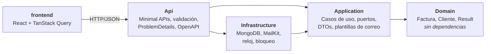
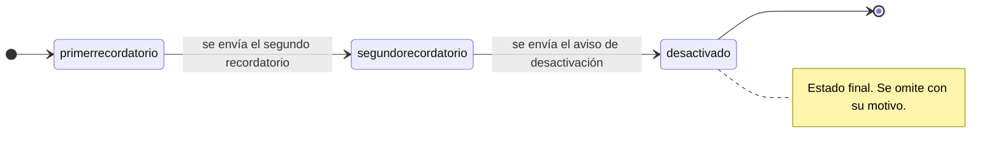
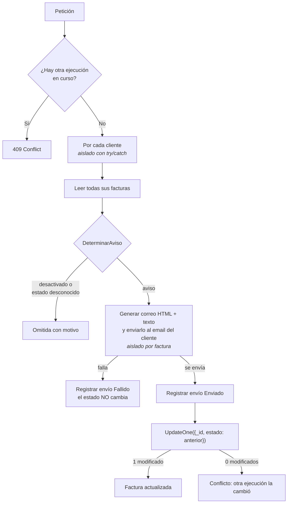
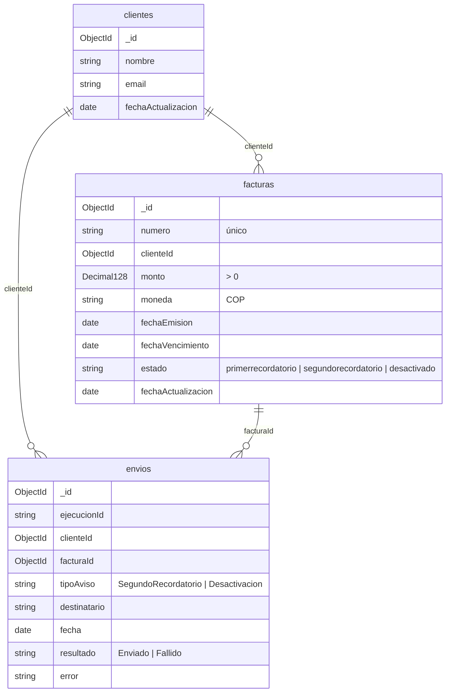

# Recordatorios de facturas

[](https://github.com/waltersilvad/Prueba_Tecnica/actions/workflows/ci.yml)

Sistema en **.NET 10 (C#) + MongoDB + React** que lee las facturas de cada cliente, envía el recordatorio que corresponde según su estado y, **solo si el correo se envió**, avanza el estado de la factura:

| Estado actual | Correo que se envía | Nuevo estado |
|---|---|---|
| `primerrecordatorio` | Segundo recordatorio | `segundorecordatorio` |
| `segundorecordatorio` | Aviso de desactivación | `desactivado` |
| `desactivado` | — (se omite con su motivo) | — |

Funciona para **N clientes independientes**: un fallo en un cliente o en una factura no detiene a los demás. La interfaz permite crear y editar clientes, crear facturas (siempre en `primerrecordatorio`), ver las facturas y el estado de cada cliente, y lanzar el proceso para **todas las facturas** o para **una sola**.

---

## Índice

1. [Inicio rápido](#1-inicio-rápido)
2. [Alternativa sin Docker completo (Visual Studio)](#2-alternativa-sin-docker-completo-visual-studio)
3. [Cómo probar el flujo](#3-cómo-probar-el-flujo)
4. [Arquitectura](#4-arquitectura)
5. [Flujo del proceso y de estados](#5-flujo-del-proceso-y-de-estados)
6. [Modelo de datos](#6-modelo-de-datos)
7. [API](#7-api)
8. [Decisiones técnicas](#8-decisiones-técnicas)
9. [Supuestos](#9-supuestos)
10. [Límites conocidos](#10-límites-conocidos)
11. [Pruebas y cobertura](#11-pruebas-y-cobertura)

---

## 1. Inicio rápido

Requisito: **Docker Desktop** (o Docker Engine con Compose v2.24+).

```bash
git clone https://github.com/waltersilvad/Prueba_Tecnica.git
cd Prueba_Tecnica
docker compose up --build
```

| Servicio | URL |
|---|---|
| Interfaz web | http://localhost:8080 |
| API | http://localhost:5080 |
| Documentación interactiva (Scalar) | http://localhost:5080/scalar |
| Salud de la API y de Mongo | http://localhost:5080/health |
| Correos generados | carpeta `./salida-correos/` (archivos `.eml`) |

No hace falta configurar nada: al arrancar se crean el esquema, los índices y **3 clientes con 10 facturas de prueba**. Por defecto los correos **no se envían**: el proveedor `Consola` guarda cada uno como `.eml` en `./salida-correos/` (se abre con doble clic en Outlook, Thunderbird o Correo de Windows).

> **¿Puerto ocupado?** Si `8080` o `5080` ya están en uso, crea un archivo `.env` con `PUERTO_WEB=8081` y/o `PUERTO_API=5081` (ver `.env.example`) y vuelve a ejecutar `docker compose up --build`.
>
> **Linux:** si la API no puede escribir en `./salida-correos`, créala con permisos de escritura: `mkdir -p salida-correos && chmod 777 salida-correos`.

Para detener todo: `docker compose down` (añade `-v` para borrar también los datos de Mongo).

## 2. Alternativa sin Docker completo (Visual Studio)

Requisitos: **.NET SDK 10**, **Node.js 24** y Docker solo para Mongo.

```bash
docker compose up -d mongo            # 1. Solo MongoDB
```

2. **API:** abre `backend/Facturacion.sln` en Visual Studio 2026 y presiona **F5** (perfil `http`). Se abre Scalar en http://localhost:5080/scalar.
   Sin Visual Studio: `dotnet run --project backend/src/Facturacion.Api`.
3. **Front:**

   ```bash
   cd frontend
   npm install
   npm run dev                         # http://localhost:5173
   ```

Con F5 los correos simulados quedan en `backend/src/Facturacion.Api/salida-correos/`.

## 3. Cómo probar el flujo

1. **Clientes** → pulsa *Editar* en un cliente y pon **tu correo** (los del seed son `@example.com`), o crea uno con **Nuevo cliente**.
2. **Facturas** → **Nueva factura**: elige el cliente, escribe un número único, el monto y las fechas. Se crea en `primerrecordatorio`.
3. En la fila de esa factura pulsa **Enviar aviso**: se envía su correo y, si sale, pasa a `segundorecordatorio`. Otra vez: aviso de desactivación y pasa a `desactivado` (el botón queda deshabilitado).
4. Para enviar varios avisos a la vez, marca las **casillas** de la derecha (o la del encabezado para todas las visibles) y pulsa **Enviar aviso de las facturas seleccionadas**. Con las mismas casillas, **Eliminar facturas seleccionadas** borra varias a la vez (cada fila también tiene su botón **Eliminar**). Mientras haya facturas marcadas, los botones individuales se bloquean. El resultado muestra, por cliente: correos enviados, facturas actualizadas, omitidas con su motivo, errores y conflictos.
5. Revisa el **Panel** (indicadores y gráficas: facturas por estado, estado por cliente y monto pendiente) y **Facturas** (filtra por estado o cliente): las de `primerrecordatorio` pasaron a `segundorecordatorio` y las de `segundorecordatorio` a `desactivado`.
   En **Envíos** está el historial de cada intento (enviado o fallido, con el motivo).
6. Abre los `.eml` de `./salida-correos/` (se abren con doble clic en cualquier cliente de correo).
7. En la barra lateral, **Borrar todos los datos** elimina clientes, facturas, envíos y los `.eml` guardados (con confirmación); **Cargar datos de ejemplo** vuelve a cargar los 3 clientes y 10 facturas (solo con la base vacía). En **Clientes** puedes eliminar un cliente: se borran también sus facturas y su historial.
8. En el **Panel**, el selector **Ver** muestra el resumen de todos los clientes o el detalle de uno (sus indicadores, facturas y últimos envíos).

Todo el flujo también se puede ejecutar desde Scalar (`/scalar`).

## 4. Arquitectura

Arquitectura limpia en 4 proyectos. Las dependencias apuntan hacia el dominio:



| Proyecto | Responsabilidad |
|---|---|
| `Facturacion.Domain` | Entidades con comportamiento: `Factura.DeterminarAviso()`, `Factura.AvanzarEstado()`, `Cliente.ActualizarDatos()`. `Result` para errores esperados. **No referencia ningún proyecto ni paquete.** |
| `Facturacion.Application` | Casos de uso (`ProcesarRecordatoriosUseCase`, consultas, edición), la regla común de cada aviso (`EnviadorAvisoFactura`) y **puertos**: `IClienteRepository`, `IFacturaRepository`, `IEnvioRepository`, `IEmailSender`, `IPlantillaCorreo`, `IReloj`, `IBloqueoEjecucion`. |
| `Facturacion.Infrastructure` | Implementa los puertos: repositorios Mongo, `ConsolaEmailSender`, `BrevoSmtpEmailSender`, esquema/índices/seed, reloj y bloqueo. |
| `Facturacion.Api` | Compone (DI) y expone HTTP. Única excepción: los endpoints de datos de prueba (solo Development) usan directamente `IDatosPrueba` de Infrastructure, porque son una herramienta de evaluación y no un caso de uso del negocio. |

**Inyección de dependencias:** cada capa expone su extensión y `Program.cs` solo las une:

```csharp
builder.Services
    .AddApplication()
    .AddInfrastructure(builder.Configuration)
    .AddApi(builder.Configuration);
```

```
├── backend/
│   ├── Facturacion.sln · global.json · Directory.Build.props · .editorconfig · Dockerfile
│   ├── src/        Domain · Application · Infrastructure · Api
│   └── tests/      Domain.Tests · Application.Tests · IntegrationTests
├── frontend/       src/{api, hooks, components, components/graficas, pages, utils} · Dockerfile · nginx.conf
├── docker-compose.yml · .env.example
└── .github/workflows/ci.yml
```

## 5. Flujo del proceso y de estados



`POST /api/recordatorios/procesar?clienteId={opcional}`:



**Un correo por factura** procesable, dirigido al cliente dueño de la factura, con asunto distinto según el aviso.

## 6. Modelo de datos

Base `facturacion`. Campos en camelCase; dinero en `Decimal128`; fechas en UTC.



- **`$jsonSchema`** en `clientes` y `facturas` (tipos, requeridos, `monto > 0`, `moneda` ISO de 3 letras, `enum` de estados).
- **Índices:** `facturas {clienteId: 1, estado: 1}`, `facturas {numero: 1}` único, `envios {clienteId: 1, fecha: -1}`.
- Se crean al arrancar con un `IHostedService` idempotente.

**Datos de prueba** (solo en Development, si la base está vacía):

| Cliente | `primerrecordatorio` | `segundorecordatorio` | `desactivado` |
|---|---|---|---|
| Comercial Andina S.A.S. | 2 | 1 | 1 |
| Distribuidora del Sur Ltda. | 1 | 2 | 0 |
| Tecnología Caribe S.A.S. | 3 | 0 | 0 |

## 7. API

Documentación completa e interactiva en **`/scalar`** (OpenAPI en `/openapi/v1.json`).

| Método | Ruta | Descripción |
|---|---|---|
| `POST` | `/api/recordatorios/procesar` | Procesa todos los clientes o uno (`clienteId`). 409 si ya hay una ejecución en curso. |
| `GET` | `/api/clientes` | Lista de clientes. |
| `POST` | `/api/clientes` | Crea un cliente (nombre y correo validados). |
| `GET` | `/api/clientes/{id}` | Detalle de un cliente. |
| `PUT` | `/api/clientes/{id}` | Edita nombre y correo (validados). |
| `GET` | `/api/facturas` | Facturas, filtros opcionales `estado` y `clienteId`. |
| `POST` | `/api/facturas` | Crea una factura en `primerrecordatorio`. 404 si el cliente no existe, 409 si el número ya existe. |
| `POST` | `/api/facturas/{id}/procesar` | Envía el aviso de una sola factura y, si sale, avanza su estado. 409 si está desactivada o hay una ejecución en curso. |
| `GET` | `/api/resumen/clientes` | Por cliente: conteo por estado, total y monto pendiente por moneda. |
| `GET` | `/api/envios` | Historial de envíos (`clienteId` opcional). |
| `DELETE` | `/api/clientes/{id}` | Elimina el cliente con sus facturas y su historial. 409 si hay un proceso en curso. |
| `POST` | `/api/facturas/procesar` | Envía el aviso de las facturas indicadas (`facturaIds`), agrupado por cliente. |
| `DELETE` | `/api/facturas/{id}` | Elimina una factura con su historial de envíos. |
| `POST` | `/api/facturas/eliminar` | Elimina las facturas indicadas (`facturaIds`); si alguna no existe no borra ninguna (404). |
| `POST` | `/api/datos/borrar` | Borra todos los datos y los `.eml` guardados. **Solo en Development.** |
| `POST` | `/api/datos/ejemplo` | Carga los datos de ejemplo (solo con la base vacía; 409 si no). **Solo en Development.** |
| `GET` | `/health` | Estado de la API y de MongoDB. |

Los errores siguen **ProblemDetails** (RFC 9457) con una extensión `codigo` (`Cliente.NoEncontrado` → 404, `Recordatorios.EjecucionEnCurso` → 409, validación → 400 con errores por campo).

## 8. Decisiones técnicas

| Decisión | Por qué |
|---|---|
| **Arquitectura limpia + puertos y adaptadores** | El dominio y los casos de uso se prueban sin Mongo ni SMTP; cambiar de proveedor de correo o de base no toca la lógica. |
| **Entidades con comportamiento** | Las reglas (qué aviso toca, qué transición es válida, que no se avanza desde `desactivado`) viven en `Factura`, no repartidas en servicios. |
| **`Result` para errores esperados, excepciones para fallos reales** | Un correo inválido o un estado final son casos de negocio. Un SMTP caído es un fallo real: lanza excepción y el caso de uso lo aísla por factura. |
| **Cada error declara su tipo** (`Validacion`, `NoEncontrado`, `Conflicto`) | La API traduce a 400, 404 o 409 por el tipo, no por cada código: un error nuevo no obliga a tocar la traducción a HTTP. El código (`Factura.EstadoFinal`, ...) viaja en la respuesta para quien necesite distinguirlo. |
| **Un caso de uso decide qué procesar; `EnviadorAvisoFactura` decide cómo** | Masivo, una factura o una selección comparten exactamente la misma regla por aviso (enviar, registrar, actualizar solo si salió) sin repetirla. |
| **Casos de uso sin interfaz** | No son puntos de variación: nadie los reemplaza por otra implementación. Lo que sí varía (persistencia, correo, reloj, bloqueo) está detrás de puertos, y las pruebas instancian los casos de uso con dobles de esos puertos. |
| **Actualización condicional** `UpdateOne({_id, estado: anterior})` | Si otra ejecución ya cambió la factura, no se pisa: se informa como conflicto. |
| **Bloqueo de ejecución + botones deshabilitados** | Evita avisos duplicados por doble clic o peticiones simultáneas (409). Eliminar un cliente, borrar todo y cargar el ejemplo comparten el mismo bloqueo: nunca se borran datos a mitad de un envío. |
| **El envío se registra antes de actualizar el estado** | Si la actualización falla después de enviar, la auditoría igual muestra que el correo salió. |
| **Proveedor `Consola` por defecto** (archivos `.eml`) | El evaluador prueba todo sin credenciales. `.eml` se abre en cualquier cliente de correo y usa el mismo `MimeMessage` que Brevo. |
| **Documentos de persistencia separados del dominio** | El dominio no conoce Mongo (ids `string`); el mapeo es explícito. |
| **`$jsonSchema` en Mongo** | Segunda línea de defensa ante datos que lleguen por fuera de la API. |
| **Opciones validadas al arrancar** (`IOptions<T>` + `ValidateOnStart`) | Una configuración inválida falla al inicio con un mensaje claro, no en mitad de un envío. |
| **`IReloj` / `TimeProvider`** | Las pruebas controlan el tiempo; nunca se usa `DateTime.Now`. |
| **Fechas en UTC, mostradas en `America/Bogota`** | Los vencimientos del seed son medianoche de Bogotá (05:00 UTC) para que la fecha mostrada coincida con el calendario. |
| **Tailwind CSS 4 con tokens semánticos y tema Claro / Oscuro / Sistema** | Cada color de la interfaz es un token con su valor claro y oscuro, así el tema se cambia con un atributo (`data-theme`) sin clases `dark:` por todo el código. Botones, tarjetas y campos son `@utility` reutilizables: el mismo aspecto y espaciado en todas las vistas. El tema elegido se recuerda en el navegador y se aplica antes de pintar la página. Las animaciones son solo de carga y respetan "reducir movimiento". |
| **Interfaz con barra lateral, Panel con gráficas (Recharts) e historial de envíos** | Colores de datos validados con un validador de accesibilidad (daltonismo y contraste) en modo claro y oscuro: los estados usan una rampa ordinal de un solo tono (la misma en etiquetas y gráficas), el monto pendiente un solo color distinto y el resultado de los envíos los colores de estado con ícono y texto. Cada gráfica tiene leyenda con valores, tooltip y vista de tabla, así que ningún dato depende solo del color ni del puntero. Las vistas se cargan de forma diferida: Recharts solo se descarga al abrir el Panel (carga inicial ~98 kB comprimidos). |
| **Montos siempre con 2 decimales** | CLDR define COP sin decimales: `Intl` redondearía 1.250.000,50 a 1.250.001. |
| **Una sola regla de correo** (`Cliente.EsEmailValido`) | La usan la entidad, FluentValidation y la validación del remitente configurado: no hay dos definiciones de "correo válido". |
| **Minimal APIs con `TypedResults`** | Los tipos de respuesta quedan en la firma y OpenAPI los documenta sin atributos. |
| **Advertencias como errores + analizadores del SDK** | La calidad no depende de la disciplina; la auditoría de NuGet bloquea paquetes vulnerables. |
| **Contenedores sin privilegios** | La API corre con el usuario `app` de la imagen oficial y el front con `nginx-unprivileged`. Los puertos se publican solo en `127.0.0.1`. |

## 9. Supuestos

- **Autenticación fuera de alcance:** la prueba no la pide; la API y el front son abiertos en local.
- **Solo tres estados** con la ortografía exacta del enunciado. Cualquier otro valor se omite con su motivo.
- **Granularidad: un correo por factura.** Cada factura procesable genera su propio correo; si sale, esa factura cambia de estado.
- El proceso trae **todas** las facturas del cliente para poder informar las omitidas.
- El monto pendiente suma las facturas en primer y segundo recordatorio, agrupado por moneda.
- **Facturas nuevas:** siempre empiezan en `primerrecordatorio` (`Factura.Registrar` no acepta otro estado). El número lo escribe el usuario y es único: lo garantiza el índice único de Mongo, sin carrera entre comprobar y guardar.
- **Aviso de una sola factura:** sigue la misma regla que el proceso masivo (solo avanza si el correo sale) y comparte su bloqueo. Pedir el aviso de una factura desactivada es un error (409), no una omisión.
- Las fechas que escribe el usuario son de calendario y se interpretan en `America/Bogota`, la misma zona en la que se muestran.
- El disparo del proceso es **manual** (botón o `POST`). El mismo caso de uso se puede conectar a un job programado sin cambios.

## 10. Límites conocidos

- **Sin atomicidad total entre enviar y actualizar.** Si el correo sale y la actualización falla, una ejecución posterior reenviaría el aviso. El historial de `envios` permite detectarlo. En producción se resolvería con un **patrón outbox**.
- **El bloqueo de concurrencia es en memoria** (una sola instancia de la API). Con varias instancias se necesitaría un bloqueo distribuido (por ejemplo, un documento de bloqueo en Mongo con TTL).
- **Mongo sin autenticación** en local: el puerto se publica solo en `127.0.0.1`.
- En Docker la API corre en **Development** para habilitar el seed y la administración de datos de prueba.
- **Un cliente inválido guardado por fuera de la API detiene las lecturas de clientes.** Las facturas que no cumplen el dominio se informan aparte (omitidas con su motivo), pero un cliente que pase el `$jsonSchema` y no la regla de correo del dominio hace fallar `GET /api/clientes` y el proceso masivo. Solo puede ocurrir escribiendo directamente en Mongo; la solución sería tratar los clientes igual que las facturas no interpretables.
- **Eliminar un cliente o borrar todo no es atómico** (MongoDB sin réplica no tiene transacciones): se borra primero lo dependiente (envíos, facturas) y al final el cliente, así que si algo falla a mitad la operación se puede repetir sin dejar registros huérfanos.

## 11. Pruebas y cobertura

```bash
dotnet test backend/Facturacion.sln          # requiere Docker para las pruebas de integración
cd frontend && npm test
```

| Proyecto | Qué cubre | Pruebas |
|---|---|---|
| `Domain.Tests` | Transiciones, avisos, invariantes, alta de facturas, `Result`, validación de clientes, tipo de cada error | 90 |
| `Application.Tests` | Casos de uso con dobles (NSubstitute): flujo completo, fallos aislados por cliente y por factura, conflictos, omitidas, bloqueo, cancelación, aviso de una sola factura, alta de clientes y facturas, selección de facturas, eliminación de clientes y facturas; plantillas de correo; tipo de cada error | 93 |
| `IntegrationTests` | MongoDB real con **Testcontainers** (esquema, índices, seed, ciclo completo, actualización condicional, número único, borrado total y carga del ejemplo, eliminación de clientes) y API con **WebApplicationFactory** (201/400/404/409, CORS incluido DELETE, OpenAPI, datos de prueba solo en Development, eliminación de facturas), validación de las opciones de salud y qué fallas SMTP se reintentan (sin conectarse a ningún servidor) | 87 |
| `frontend` | Vitest + React Testing Library: Panel (indicadores, leyendas y vista de tabla de las gráficas), historial de envíos (incluida la tabla responsiva), navegación, selector de tema, tabla de facturas (y "Enviar aviso"), formularios de cliente y factura, selección y envío en lote, eliminación de clientes y facturas (individual y por selección), borrar y cargar datos, Panel por cliente, formato | 52 |

Cobertura del backend (coverlet, sin el código que generan los source generators):

| Capa | Suite que la mide | Líneas | Ramas |
|---|---|---|---|
| Domain | `Domain.Tests` | 100 % | 100 % |
| Application | `Application.Tests` | 93,8 % | 100 % |
| Api | `IntegrationTests` | 98,2 % | 86,4 % |
| Infrastructure | `IntegrationTests` | 89,9 % | 85,3 % |

En Application, lo no cubierto por las pruebas unitarias es el registro de DI y los *getters* de los DTOs (los ejercitan las pruebas de integración). En Infrastructure es sobre todo el envío real por SMTP con Brevo, que necesitaría un servidor externo.

Para generar el reporte:

```bash
dotnet test backend/Facturacion.sln --settings backend/coverlet.runsettings
```

La CI lo publica como artefacto (`cobertura-backend`).
